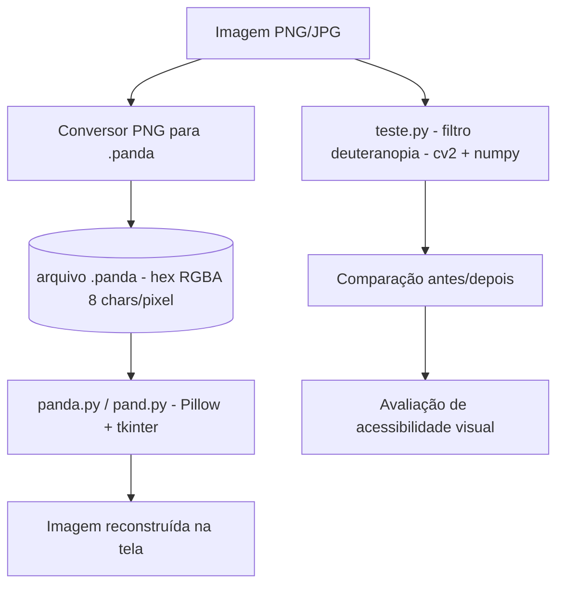

# 🐼 color-blind-cam — Simulador de Daltonismo para Imagens

<p align="center">
  
  <a href="https://github.com/panda12332145/color-blind-cam/commits/main"></a>
  <a href="https://github.com/panda12332145/color-blind-cam"></a>
  
  
</p>

---

## 🔖 Resumo

**color-blind-cam** é um toolkit em Python que simula a **visão de uma pessoa com daltonismo (deuteranopia)** sobre qualquer imagem — e inclui um formato de imagem próprio (`.panda`) com renderizador em tkinter. Feito para estudar percepção de cor, processamento de imagens e como acessibilidade afeta o design visual.

### ✨ Funcionalidades Principais

- ✅ **Simulação de deuteranopia** — `teste.py` aplica o filtro daltonismo na imagem
- ✅ **Formato de imagem próprio (`.panda`)** — pixels RGBA em hexadecimal, 8 caracteres por canal
- ✅ **Renderizador `.panda`** — `panda.py` e `pand.py` desenham o formato com Pillow + tkinter
- ✅ **Conversão PNG → `.panda`** — exporta imagens para o formato próprio
- ✅ **Suporte a webcam** — captura de vídeo quando aplicável
- ✅ **Extensível** — base para outros tipos de daltonismo (protanopia, tritanopia)

---

## 📽 Demonstração

```text
$ python teste.py

# Carrega a imagem → aplica filtro deuteranopia → mostra lado a lado

Original          |  Deuteranopia simulada
(verde vs vermelho)|  (tons amarronzados iguais)
```

```text
$ python panda.py

# Renderiza imagem panda.png no formato .panda (tkinter)
```

---

## ⚙️ Explicação das Partes Importantes

### Simulação de daltonismo (`teste.py`)
```python
import cv2, numpy as np

img = cv2.imread('imagem.png')
# matriz de simulação deuteranopia (aproximação clássica)
M = [[0.625, 0.375, 0.0],
     [0.700, 0.300, 0.0],
     [0.000, 0.300, 0.700]]
deuteranopia = np.dot(img.reshape(-1, 3), np.array(M).T)
```
> A matriz remapeia RGB para como um daltônico percebe os canais — o verde e o vermelho colapsam em tons parecidos.

### Formato `.panda` (conversor)
```python
# cada pixel vira 8 caracteres hex: RRGGBBAA
hex_color = f"{r:02X}{g:02X}{b:02X}{a:02X}"
arquivo.write(hex_color + '\n')
```
> Formato texto puro e legível — ótimo para entender como imagens são armazenadas por baixo.

### Renderizador (`panda.py` / `pand.py`)
```python
from PIL import Image, ImageTk
import tkinter as tk

# lê o .panda, reconstrói os pixels e exibe na janela tkinter
```
> Do formato texto de volta para pixels na tela — o ciclo completo de um formato de imagem.

---

## 🔄 Fluxo de Trabalho / Arquitetura



---

## 📂 Estrutura do Projeto

```plaintext
color-blind-cam/
├── teste.py           # 🧠 Simulação de deuteranopia (cv2 + numpy)
├── panda.py           # 🐼 Renderizador do formato .panda
├── pand.py            # 🐼 Variação do renderizador
├── webcam_test.py     # 📷 Teste com webcam
├── panda.png          # Imagem de exemplo
├── imagem.panda       # Exemplo no formato próprio
├── LICENSE            # 📜 MIT
└── README.md
```

---

## 🛠️ Tecnologias

| Ferramenta | Uso |
|---|---|
| **Python 3** | Linguagem principal |
| **OpenCV (`cv2`)** | Leitura/filtros de imagem e webcam |
| **NumPy** | Matrizes de transformação de cor |
| **Pillow (PIL)** | Renderização de imagens |
| **tkinter** | Janelas/gráficos nativos do Python |

---

## ▶️ Instalação

```bash
git clone https://github.com/panda12332145/color-blind-cam.git
cd color-blind-cam

pip install opencv-python numpy pillow
```

---

## 🚀 Execução

```bash
python teste.py        # simula deuteranopia em imagem
python panda.py        # renderiza arquivo .panda
python pand.py         # renderizador alternativo
python webcam_test.py  # teste com webcam (se houver)
```

---

## 🧪 Testes

1. Rode `teste.py` com uma imagem colorida (verde/vermelho) e compare antes/depois
2. Converta uma PNG para `.panda` e confira o formato hex na saída
3. Renderize o `.panda` com `panda.py` e confirme que a imagem aparece na janela

---

## ⚠️ Limitações

- Simulação de deuteranopia é uma **aproximação** (não substitui exame oftalmológico)
- Formato `.panda` é didático — não otimizado (texto, sem compressão)
- Sem tratamento de erro robusto para arquivos corrompidos

---

## 🚀 Roadmap

- [x] Filtro de deuteranopia
- [x] Formato `.panda` + renderizadores
- [ ] Protanopia e tritanopia
- [ ] CLI unificada (`colorblind simulate img.png`)
- [ ] Comparação lado a lado em janela única
- [ ] Versão web (Streamlit)

---

## 📄 Licença

MIT License — veja [`LICENSE`](LICENSE).

---

## 👾 Autor

<p align="center">
  
</p>

<p align="center">Feito por <strong>Panda12332145</strong> 👋🏽</p>

---

## 🧑‍💻 Sobre Mim

Sou apaixonado por **Física Teórica, Cibersegurança e Desenvolvimento de Sistemas**. Tenho grande interesse em programação de baixo nível, engenharia reversa, automação, sistemas Windows, criptografia e segurança ofensiva. Também gosto bastante de música, filosofia e computação avançada.

---

## 🌐 Redes

* **Site:** [https://panda-h0me.netlify.app/](https://panda-h0me.netlify.app/)
* **YouTube:** [https://www.youtube.com/@X86BinaryGhost](https://www.youtube.com/@X86BinaryGhost)
* **Instagram:** [https://www.instagram.com/01pandal10/](https://www.instagram.com/01pandal10/)
* **GitHub:** [https://github.com/panda12332145](https://github.com/panda12332145)
* **LinkedIn:** [linkedin.com/in/athos-da-boanergis](https://www.linkedin.com/in/athos-d%C3%A3-boanergis-5585a4288/)

---

## 🚀 Áreas de Interesse

* **Cibersegurança Avançada** 🔒
* **Hacking & Engenharia Reversa** 💻
* **Computação de Baixo Nível** 🖥️
* **Matemática e Física Teórica** 📐⚛️
* **Desenvolvimento de Ferramentas de Segurança** 🛠️

_"Conhecimento é poder, e domínio técnico vem da compreensão profunda dos sistemas."_

---

## 📞 Contato & Suporte

Para colaborações, dúvidas ou sugestões:

📧 **E-mail:** [athos.cybersec@gmail.com](mailto:athos.cybersec@gmail.com)

🐛 **Reportar Bug:** [Abrir Issue](https://github.com/panda12332145/color-blind-cam/issues)

💡 **Sugerir Melhoria:** [Discussions](https://github.com/panda12332145/color-blind-cam/discussions)
